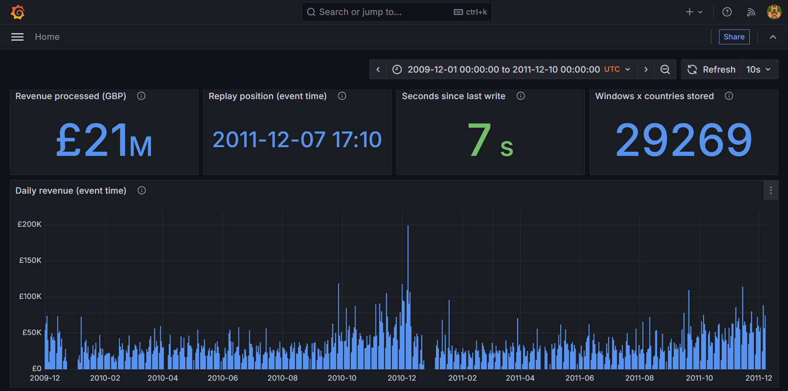

# Real-Time Data Backend for a Data-Intensive Retail Application

DLMDSEDE02 &middot; Portfolio &middot; Task 2 (real-time) &middot; Suprit Somashekaraiah

A streaming pipeline that replays the UCI **Online Retail II** dataset
(1,067,371 timestamped rows) as a checkout-style event stream, ingests it
through **Apache Kafka**, cleans and aggregates it with **Spark Structured
Streaming** (5-minute tumbling windows, 2-minute watermark), stores the
result in **PostgreSQL** and shows it live in a **Grafana** dashboard.
Every component is its own isolated Docker container; the whole stack is
defined as code in `docker-compose.yml`.

```
producer (Python) --> Kafka --> Spark Structured Streaming --> PostgreSQL --> Grafana
   ingestion          buffer     pre-processing + aggregation    serving       report
```

| Service    | Image                                   | Role                                   |
|------------|-----------------------------------------|----------------------------------------|
| `producer` | custom, `python:3.12-slim`              | replays the CSV into Kafka             |
| `kafka`    | `apache/kafka:4.1.0` (KRaft, official)  | event buffer, 3 partitions             |
| `spark`    | custom, `apache/spark:3.5.3-python3`    | cleaning + windowed aggregation        |
| `postgres` | `postgres:16` (official)                | serving table `country_revenue_5min`   |
| `grafana`  | `grafana/grafana:11.4.0` (official)     | real-time report, provisioned as code  |

## 1. Prerequisites

- Docker Desktop (or Docker Engine + the Compose plugin) installed and running
- ~6 GB of free RAM for all five containers
- Internet access on first start (image pulls; Spark downloads the Kafka connector from Maven)
- The dataset (see below)

## 2. Get the dataset

Download **Online Retail II** from UCI:
https://archive.ics.uci.edu/dataset/502/online+retail+ii

Combine both sheets into one CSV named `online_retail_ii.csv` and place it
in `data/`. Instructions and a pandas snippet are in `data/README.md`.

## 3. Configure

```bash
cp .env.example .env
```

Open `.env` and set your own Postgres passwords, replace every `change-me` value in `.env`. `.env` is gitignored — it never gets committed.

## 4. Run it

```bash
docker compose up --build
```

Startup order is enforced by healthchecks: Kafka and Postgres must be
healthy before the producer, Spark and Grafana start.

> **Upgrading from the Phase 2 version?** Run `docker compose down -v`
> once first. The old Postgres volume does not contain the new read-only
> report role, and the old Postgres table and Spark checkpoint contain
> aggregates built from wrongly parsed dates (see "Changes in Phase 3").

## 5. Check it works



**Dashboard:** open http://localhost:3000, log in as `admin` with
`GRAFANA_ADMIN_PASSWORD`. The "Retail real-time report" dashboard opens and
refreshes every 10 s: revenue processed, replay position, seconds since the
last write (freshness), daily revenue, top countries, latest windows.

**SQL:**

```bash
docker compose exec postgres psql -U postgres -d retail \
  -c "SELECT * FROM country_revenue_5min ORDER BY window_start DESC LIMIT 10;"
```

**Logs:** `docker compose logs -f producer spark` &mdash; the producer logs
every 5,000 events sent; Spark logs `upserted N rows` every 30 seconds.

**Status:** `docker compose ps` &mdash; all five services `Up`, the ones
with healthchecks `(healthy)`. When the replay ends the producer exits with
code 0 and stays stopped (by design, see below).

### Verified run (Phase 3)

Clean start (`docker compose down -v`, then `up`), `REPLAY_SPEEDUP=100000`:

| Check | Result |
|---|---|
| Producer | `Done. Sent 1067371 events, skipped 0 malformed rows.` in about 11 min, then `Exited (0)` |
| Serving table | 29,389 rows in `country_revenue_5min` |
| Earliest window | 2009-12-01 07:45, the first invoice in the dataset (date fix works) |
| Windows with revenue <= 0 | 0 (zero-price filter works) |
| Freshness during the run | 7 s since last write (trigger every 30 s) |
| Containers | kafka, postgres, spark, grafana healthy throughout |

With the default `REPLAY_SPEEDUP=3600` the same replay takes roughly 2 to 2.5 hours.
Keep the machine awake: if it sleeps, Docker pauses and the replay stalls.

## 6. Tests

The parsing, cleaning and windowing logic is tested without Docker:

```bash
pip install -r tests/requirements.txt   # needs Java 17+ for PySpark
pytest tests
```

## 7. Stop it

```bash
docker compose down          # stop containers, keep data
docker compose down -v       # also wipe Kafka/Postgres/Spark/Grafana volumes
```

## Project layout

```
docker-compose.yml        # the whole stack, as Infrastructure as Code
.env.example              # config template (copy to .env, never commit .env)
producer/                 # ingestion microservice (custom image)
spark/                    # pre-processing + aggregation microservice
postgres/init/            # schema, writer role, read-only report role
grafana/provisioning/     # datasource + dashboard provider (as code)
grafana/dashboards/       # the dashboard JSON
docs/event-schema.md      # data contract, lineage, access matrix
tests/                    # unit tests for producer and Spark logic
data/                     # put online_retail_ii.csv here (gitignored)
```

## Design notes

- **Reliability** &mdash; every service has a restart policy, and Kafka,
  Postgres, Spark and Grafana have healthchecks; Spark checkpoints its Kafka offsets and window state
  to a named volume, so a restarted job continues where it stopped; the
  Postgres write is an idempotent upsert on the primary key, so a replayed
  micro-batch overwrites rather than duplicates. The producer uses
  `restart: on-failure`: it restarts after a crash but not after a
  successful replay, which would otherwise send the dataset again.
- **Scalability** &mdash; Kafka's 3 partitions (keyed by invoice) let up to 3
  Spark tasks or consumer instances read in parallel; producer and
  consumer scale independently because Kafka decouples them.
- **Maintainability** &mdash; all config in `.env`, all images pinned, one
  service per concern, transformations split into small tested functions.
- **Security / governance / protection** &mdash; Kafka has no host port;
  Postgres and Grafana bind to `127.0.0.1` only; Spark writes as
  `retail_app` (one table, no DDL) and Grafana reads as `report_reader`
  (SELECT only, read-only sessions); secrets only in the gitignored `.env`;
  Kafka retention bounded to 7 days / 2 GB per partition; producer and
  Spark run as non-root users; the data contract and lineage are in
  `docs/event-schema.md`.

## Changes in Phase 3

- **Fixed a date-parsing bug.** The producer used
  `dateutil.parse(dayfirst=True)`, which reads ISO dates such as
  `2009-12-01` as 12 January. Every date with a day of 12 or less was put in
  the wrong month, and the Spark watermark then dropped many of those events
  as "late". Visible symptom in Phase 2: windows dated 2011-12-10, after the
  dataset's last day. ISO dates are now parsed strictly; regression test in
  `tests/test_producer.py`.
- **Zero-price rows filtered** (`unit_price > 0`): they produced windows
  with revenue 0.00 but items > 0.
- **Reporting layer added:** Grafana, provisioned as code, read-only role.
- **Reproducibility:** added the missing `.env.example` and `.gitignore`;
  pinned `apache/kafka` (was `:latest`).
- **Producer restart policy** changed to `on-failure`; Spark healthcheck
  added; explicit Kafka retention; Spark session time zone fixed to UTC.

## Known limitations

- Single broker, single Spark executor, local machine only (the brief asks
  for local development). No replication, so a broker failure stops ingestion.
- Kafka traffic is plaintext inside the Docker network; no TLS/SASL.
- No schema registry: the data contract is documented, not enforced.
- Spark downloads the Kafka connector from Maven at first start.
- Micro-batches every 30 s: end-to-end latency is seconds, not milliseconds.
